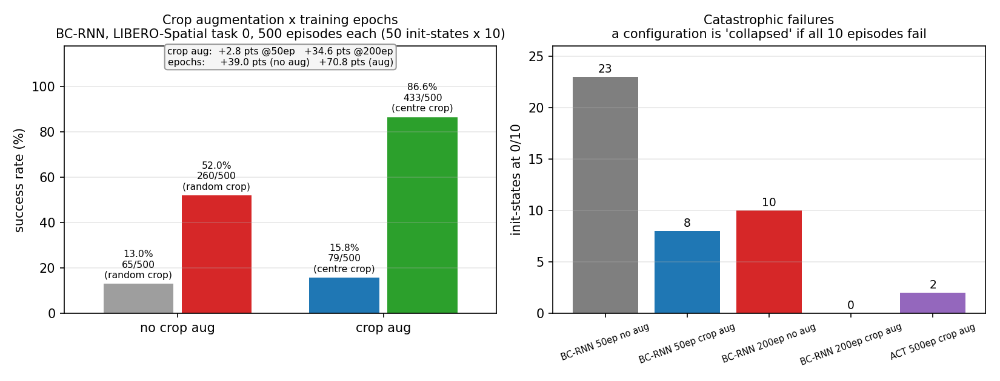
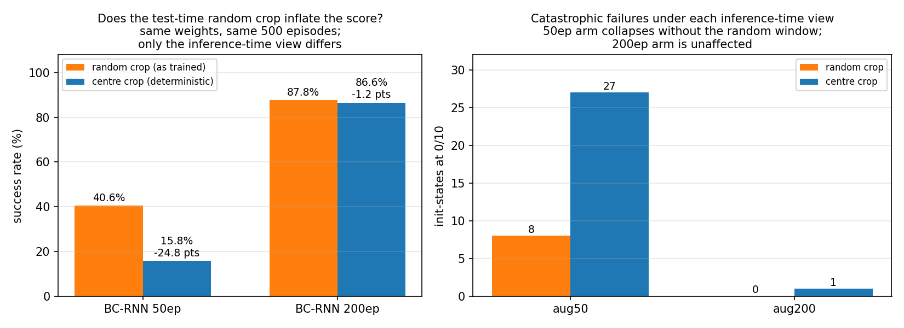
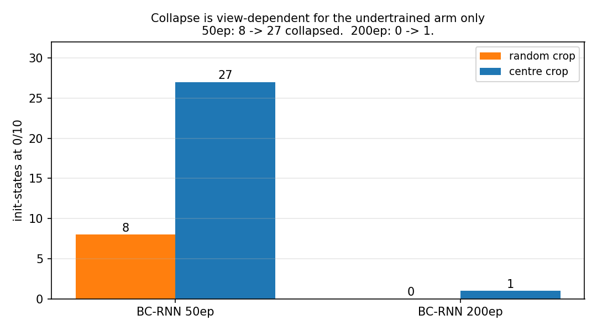
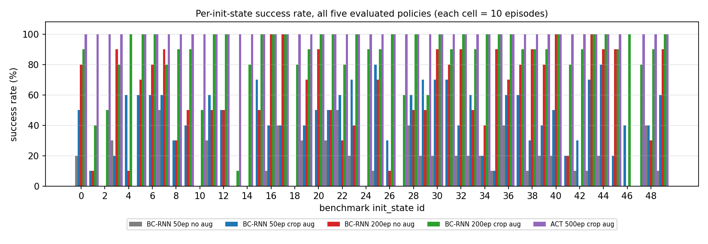
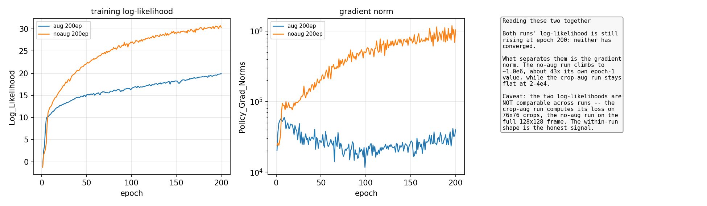

# Imitation policies on LIBERO-Spatial task 0: what actually moved the success rate

> Trained **five policies** on the same 50 demonstrations of LIBERO-Spatial task 0
> (*"pick up the black bowl between the plate and the ramekin and place it on the
> plate"*) and evaluated each on the **full 500-episode benchmark protocol**
> (50 init-states × 10 episodes). Best is **ACT at 96.0%**; the clearest finding is
> that **crop augmentation removes catastrophic failure rather than raising the
> average**, and that **gradient norm — not training loss — is what predicted which
> runs would work**.

**Everything in §2 is a number from a committed CSV. §7 lists what is still missing
and §8 lists what I could not verify.** No number here is projected or copied.

---

## 1. Setup

| | |
|---|---|
| Benchmark | LIBERO-Spatial, suite `libero_spatial`, **task 0 only** (of 10) |
| Task 0 | `pick up the black bowl between the plate and the ramekin and place it on the plate` — read from `libero.libero.benchmark`, not inferred from filenames |
| Goal predicate | `(And (On akita_black_bowl_1 plate_1))`, from the task `.bddl` |
| Demonstrations | 50 scripted, 5068 steps, T = 75…168 (mean 101.4) |
| **Eval protocol** | **all 50 benchmark init-states × 10 episodes = 500 episodes**, max 400 steps, `env.seed(0)` |
| Success criterion | the env's own `_check_success()`, surfaced as `done` from `env.step()` |
| Hardware | 1× RTX 4060 Laptop (8 GB), CUDA 12.1, torch 2.2.2+cu121 |
| Training seed | 10000 (BC-RNN), 42 (ACT) — identical across the matched pairs |

### Observation / action space

```
agentview_rgb     (128,128,3)   third-person camera
eye_in_hand_rgb   (128,128,3)   wrist camera
gripper_states    (2,)  joint_states (7,)  robot_states (9,)
actions           (7,)   Δee_pos(3) + Δee_axisangle(3) + gripper(1), OSC_POSE @ 20 Hz
```

Shapes were audited against the dataset and env, not assumed — see
`docs/notes/day2note.md` §1–2. The three different `done` signals in this stack are
disambiguated with `file:line` refs in `docs/notes/day3note.md` §3.

---

## 2. Results — the ablation

Five policies, one protocol. Every row re-summable from its CSV in `results/`.

| Policy | Epochs | Crop aug | Inference view | Success | Collapsed init-states¹ | Source |
|---|---|---|---|---|---|---|
| BC-RNN | 50 | no | full frame | **13.0%** (65/500) | 23 / 50 | `results/bcrnn_noaug50_full_eval.csv` |
| BC-RNN | 50 | yes | random crop | 40.6% (203/500) | 8 / 50 | `results/bcrnn_aug50_full_eval.csv` |
| BC-RNN | 50 | yes | **centre crop** | **15.8%** (79/500) | 27 / 50 | `results/bcrnn_aug50_center.csv` |
| BC-RNN | 200 | no | full frame | **52.0%** (260/500) | 10 / 50 | `results/bcrnn_noaug200_full_eval.csv` |
| BC-RNN | 200 | yes | random crop | 87.8% (439/500) | **0 / 50** | `results/bcrnn_aug200_full_eval.csv` |
| BC-RNN | 200 | yes | **centre crop** | **86.6%** (433/500) | 1 / 50 | `results/bcrnn_aug200_center.csv` |
| **ACT** | 500 | yes² | random crop | **96.0%** (480/500) | 2 / 50 | `results/act_500ep_full_eval.csv` |

¹ "collapsed" = all 10 episodes fail at that init-state.



² ACT's training config has no crop augmentation; see §9 for the ACT patch list.

**The "inference view" column is not a footnote — it changes the answer by 25
points.** Crop-augmented policies are architecturally unable to see the full frame
(§7.3), and at 50 epochs their score depends heavily on *which* 76×76 window they
get. §2.2 quantifies this. The comparison below uses the **centre-crop** numbers,
because those are the only ones measured under a deterministic single view.

### 2.1 The two factors, separated (deterministic centre-crop view)

|  | no crop aug | crop aug | effect of aug |
|---|---|---|---|
| **50 epochs** | 13.0% | 15.8% | **+2.8 pts** |
| **200 epochs** | 52.0% | 86.6% | **+34.6 pts** |
| **effect of epochs** | **+39.0 pts** | **+70.8 pts** | |

Under the random-crop view the same table reads +27.6 / +35.8 for augmentation and
+39.0 / +47.2 for epochs. Both are defensible measurements of *different things*:
the random-crop table describes the policy **as it is normally deployed**, the
centre-crop table describes the policy **as a deterministic function of its input**.

The substantive finding is the interaction: **augmentation is worth almost nothing
at 50 epochs (+2.8) and almost everything at 200 (+34.6).** The 50-epoch augmented
policy has not yet learned to use the crop invariance it was trained on. Any claim
that "crop augmentation gives a reliable gain" is false at this training budget.

Both factors help, they are not redundant, and the seed is held fixed within each
row/column pair. The BC-RNN configs differ in exactly two fields
(`experiment.name` and `obs_randomizer_class`), so the aug/no-aug comparison is a
clean single-variable ablation — I diffed the configs to confirm this.

### 2.2 The test-time random crop is doing real work — but only for the undertrained arm

I re-evaluated both crop-aug arms with the random crop replaced by a deterministic
centre crop of the same size. Same weights, same 500 episodes, same seed; the only
difference is which 76×76 window the policy sees.

| arm | random crop | centre crop | Δ | collapsed (random → centre) |
|---|---|---|---|---|
| **aug 50ep** | 40.6% | 15.8% | **−24.8 pts** | 8 → **27** |
| **aug 200ep** | 87.8% | 86.6% | **−1.2 pts** | 0 → 1 |





Two conclusions, and the first one corrected a wrong assumption of mine:

1. **The 87.8% is real.** I had expected the score to collapse toward the no-aug
   baseline if it were an artefact of train/test distribution matching. It moved by
   1.2 points. The 200-epoch policy does not need the random window, so its score
   is a genuine property of the weights.
2. **The 50-epoch policy does need it — and that means I had been overstating the
   50-epoch cell.** Under centre crop it drops to 15.8% with 27 collapsed
   init-states, and every one of the 8 init-states that collapsed under the random
   view still collapses (none are rescued). A large part of that 40.6% was the
   policy benefiting from a view distribution it saw in training but that a
   deployed system would not have.

The generalisable form: **an under-trained policy's closed-loop score can be
substantially borrowed from test-time input variability, and the borrow disappears
as training converges.** I would not have detected this without deliberately
breaking a component of my own evaluation.

### 2.3 Where the augmentation gain sits, by init-state

Breaking the 35.8-point aug gain at 200 epochs down by init-state (random-crop
view, the only one where both arms are directly comparable):

| group | no aug | crop aug | episodes gained | share of the 35.8 |
|---|---|---|---|---|
| 10 init-states where no-aug is **0/10** | 0/100 | 69/100 | **+69** | **38.5%** |
| the other 40 init-states | 260/400 | 370/400 | **+110** | **61.5%** |

Both statements are true and they are different statements:

- **Per configuration**, the gain is concentrated where it matters most: the 10
  collapsed init-states recover from 0% to 69% (avg +6.9/10), versus +2.75/10 on
  the rest. Crop aug **rescues catastrophic failure.**
- **By total score**, most of the gain comes from the 40 already-working
  configurations going 65% → 92.5%.

Collapse counts make the same point across all five policies: 23 → 8 → 10 → **0**
for the BC-RNN grid, and 2 for ACT. The 200-epoch crop-aug run is the only policy
with **zero** collapsed init-states.



### 2.4 Training dynamics — the part I did not expect



| run | final `Log_Likelihood` | final `Policy_Grad_Norms` | closed-loop |
|---|---|---|---|
| no aug, 50 ep | 21.948 | 150,661 | 13.0% |
| no aug, 200 ep | **30.346** | **1,039,838** | 52.0% |
| crop aug, 200 ep | 19.878 | 39,804 | 87.8% |

Three things, and the third is the one I'd have got wrong without looking:

1. **The no-aug run reaches the *best* training log-likelihood (30.3) and the
   *worst* closed-loop score of the three.** Fitting the demos better did not help.
2. **Its gradient norm blows up to ~1.0e6, about 43× its own epoch-1 value**, and
   keeps climbing. The crop-aug run sits flat at 2–4e4 for all 200 epochs. This is
   the signature that predicted which policy would work, and it is visible from the
   logs alone — no evaluation needed.
3. **The two log-likelihoods are NOT comparable across runs.** The crop-aug run
   computes its loss on 76×76 crops; the no-aug run on the full 128×128 frame.
   Part of the 10.5-point gap is "the task got harder", not "fitting got worse".
   Any claim of the form "lower loss but better policy" has to carry this caveat.
   The *within-run* shape (still rising at epoch 200 — neither run converged) is
   the honest signal.

Note the direction of the correlation **reverses depending on scope**, which is why
I am not stating a general rule: *within* the no-aug family, higher loss goes with
higher closed-loop score (13.0% → 52.0% as loss goes 21.9 → 30.3); *across*
families, the lower-loss run has the higher score. Both are in the table above.

### 2.5 ACT vs BC-RNN

ACT is **8.2 points ahead** (96.0% vs 87.8%) at the same 500-episode protocol, and
the failure structure differs — see §4. Two caveats: ACT has 84M parameters vs
BC-RNN's much smaller head, and ACT was trained for 500 epochs against BC-RNN's
200, so this is a comparison of two finished configurations, not of the
architectures in isolation.

ACT's 48/50 perfect init-states and 2 total failures is an unusually clean split.
I could not find an intermediate value (5/10, 8/10) anywhere in its CSV. That is
consistent with a systematic failure mode rather than stochastic noise, but I have
not verified it (§8).

### 2.6 Rollout clips

`media/rollouts/` is **intentionally empty**. 89 clips exist in the working
directory but none are published: the directory was written by more than one run,
and spot-checking frames showed a clip labelled `SUCCESS` in which the bowl does not
visibly move. Full write-up and the re-record command:
[`media/rollouts/README.md`](media/rollouts/README.md).

At 128×128 I also cannot confirm the failure mode from video at all — neither the
bowl leaving the ramekin area nor a grasp closing on nothing is legible. So §4's
mechanism claim currently rests on the kinematic census, not on pictures.

---

## 3. Perturbation experiment — reported as data, not as a conclusion

`results/perturbation/` holds six CSVs. They are included because they are real
measurements, **not** because they support a clean claim.

Displacing the bowl along +x and re-measuring (`day_perturbation.py`, init_state 0,
10 episodes per level):

| offset | BC-RNN (0–50 sweep) | BC-RNN (12.5–17.5 sweep) | ACT (both) |
|---|---|---|---|
| 0 mm | 80% | — | 100% |
| 10 mm | 50% | — | 100% |
| 12.5 mm | — | 60% | 100% |
| **15 mm** | — | **0%** | **100%** |
| 17.5 mm | — | 60% | 100% |
| 20–50 mm | 0% | — | 0% |

**Two independent BC-RNN runs both collapse to exactly 0/10 at exactly 15.0 mm,
while the levels on either side score 60%.** A monotone degradation would be a
result; a single-point hole between two healthy points is more likely a bug or an
unexplained geometry interaction. I am not publishing a "failure boundary" figure
until that is explained.

Also unresolved: `day_plot_curve.py` reads the sweep files into one dict keyed by
offset, so the later file silently overwrites the earlier one — the repeat run is
dropped from the plot without warning. And 4 of the 6 CSVs use offsets
(12.5/15/17.5) that are not in the design as documented in `docs/notes/day7note.md`.

---

## 4. Failure analysis

### 4.1 Automated census (ACT, 3 init-states, 10 episodes each)

`day_failure_census.py` logs, every step: the 2-D gripper↔bowl distance in mm,
whether the bowl rose, and whether it fell again; then labels each episode
`success` / `locate_fail` / `align_fail` / `drop` / `other`, splitting locate vs
align at 60 mm.

| init-state | success | locate_fail | align_fail | drop | other |
|---|---|---|---|---|---|
| 13 | 10 | 0 | 0 | 0 | 0 |
| 4 | 0 | 0 | 0 | **10** | 0 |
| 46 | 0 | 0 | 0 | **10** | 0 |

Source: `results/census_act_state{13,4,46}.csv`. **These three CSVs are the only
failure-mode artifacts that exist** — there is no BC-RNN census output, so the
"complementary failure modes" claim below is currently half-evidenced (§8).

The ACT failures are not localization failures. The bowl is lifted and then dropped,
in 20/20 episodes across the two init-states where ACT fails at all.

### 4.2 Complementary failure modes — promising, not yet established

`docs/notes/day7note.md` §10 records the intended comparison: BC-RNN dies from
localization failure (cannot reach within ~55 mm), ACT dies from grasping-and-
dropping. That would be a genuinely interesting result — swapping the policy fixes
one failure mode and introduces another.

But the BC-RNN side of that table has no artifact behind it, and the table as
written in the notes is internally inconsistent (its init-13 row reads
"定位失败(10%) 成功(100%)", which sums to 110%). The ACT half is now backed by the
three CSVs above. **Run the census on BC-RNN before this goes in a README as a
claim** — one command:

```bash
python scripts/failure_census.py --ckpt <bc_rnn_aug200.pth> --init-states 1 2 10 13 --episodes 10
```

### 4.3 Three hypotheses, all refuted by matched controls

Static object-position tables were tried first and were not sufficient. All three
geometric hypotheses about the hard init-states were killed by finding a
*control* init-state with similar geometry and high success:

| # | Hypothesis | Refuted by |
|---|---|---|
| 1 | failure correlates with the bowl being far from the demonstrator's start pose | init 11 has a near-identical bowl position to the #1 failure case, yet scores 100% |
| 2 | failure correlates with a tight ramekin gap | #13 has a 16.7 mm gap; the tighter #38 (14.6 mm) still scores 90% |
| 3 | failure correlates with the cookie box blocking the approach | in #13 the bowl is *further* from the cookies than in the easy cases |

The move that mattered was the control group, not the hypotheses: a correlate found
in a 50-row table is not a cause until you find the case with similar geometry that
succeeds. `docs/notes/day7note.md` §3–5.

### 4.4 Identical inputs do not give identical rollouts

Twenty episodes from the *same* init-state with the *same* env seed gave 1 success
(`docs/notes/day6note.md` §1), and init 13 measured 1/10 and 3/10 on separate
occasions. cuDNN LSTM is not bitwise-deterministic on GPU, and small numeric
differences diverge into different trajectories.

**This is why every number in §2 is 500 episodes and none of them is a single
run**, and why no standard deviation is reported: repetition is over episodes, not
over seeds (§7.2).

I also found that the crop-aug policy is **non-deterministic at inference by
design** — see §9.3. That is a larger source of run-to-run variation than GPU
non-determinism, and it is not currently accounted for in any of these numbers.

---

## 5. Repository layout

```
configs/bc_rnn_task0.json       BC-RNN hyperparameters, paths tokenised
scripts/
  download_data.sh              dataset fetch (LIBERO's own downloader by default)
  prepare_data.py               adds the next_obs group robomimic needs  [verified exact]
  train_bc_rnn.py               robomimic launcher, no hardcoded paths
  eval.py / eval_act.py         BC-RNN and ACT eval, identical protocol
  failure_census.py             per-step kinematics -> failure labels -> CSV
  plot_curves.py                loss / ACT curves
  plot_ablation.py              the 2x2, per-init-state, and log figures
act/                            vendored ACT + patches (see §9)
docs/notes/                     dated lab notes, chronological, unedited
results/                        every measured CSV + a README on what is missing
logs/                           BC-RNN training logs (text), ACT log (csv)
media/figures/                  six figures, all generated from committed logs
                                (2x2, per-init-state, log curves, ACT curve,
                                test-time-crop effect, collapse counts)
media/rollouts/                 empty on purpose, see the README there
env/requirements.txt            pinned environment
```

### 5.1 Scripts are ports, and every diff is documented

Each `scripts/*.py` has a `PROVENANCE` header naming the working script it came
from and separating **what changed** from **what was deliberately left unchanged**.
For `eval.py` the unchanged list is the load-bearing part: rollout loop, observation
translation, env construction, `env.seed(0)` and `MAX_STEPS=400` are unchanged,
because they are what produced these numbers.

| Script | Verified how far |
|---|---|
| `prepare_data.py` | **fully** — rebuilt the patched dataset and compared 350 arrays across 50 demos against the file the original ad-hoc patch produced. Byte-for-byte identical, 0 mismatches. |
| `eval.py` | **exercised on all four BC-RNN arms at full scale** — the `bcrnn_aug200_center.csv` and `bcrnn_aug50_center.csv` rows in §2 were produced by it, 500 episodes each. Also smoke-tested on the `as-trained` path (init-state 0, 3 episodes, 3/3 at steps 76/79/75) and with `--video-dir`. |
| `plot_curves.py`, `plot_ablation.py` | **fully** — re-reads the committed CSVs and re-derives every rate; output is printed on each run |
| `failure_census.py` | syntax only — **never executed by me** (the ACT census CSVs came from `day_failure_census.py`, the script it was ported from) |
| `eval_act.py` | syntax only — **never executed by me** (the ACT CSV came from `day_act_full_eval.py`) |
| `train_bc_rnn.py` | `--dry-run` path tested (token resolution, `--set` overrides); the robomimic call itself not re-run |

---

## 6. Reproducibility

### 6.1 Install

```bash
pip install torch==2.2.2 torchvision==0.17.2 --index-url https://download.pytorch.org/whl/cu121
pip install -r env/requirements.txt
git clone https://github.com/Lifelong-Robot-Learning/LIBERO.git LIBERO
pip install -e ./LIBERO
```

Python 3.10.12, numpy 1.23.5, robomimic 0.2.0, robosuite 1.4.0, mujoco 3.8.1,
einops 0.8.2, LIBERO 0.1.4 (editable).

### 6.2 Data

```bash
bash scripts/download_data.sh
python scripts/prepare_data.py --in <demo>.hdf5 --out data/libero_spatial/task0_nextobs.hdf5
```

The released demos ship `obs` but not `next_obs`, which robomimic's
`SequenceDataset` requires. `prepare_data.py` adds it:

```
next_obs[t] = obs[t + 1]   for t < T-1
next_obs[T-1] = obs[T-1]            (final step self-copies)
```

mirroring all 7 obs keys with identical shapes/dtypes, preserving demo attrs
(`model_file` matters — the MJCF is read from it). The original ad-hoc patch was
not saved, so this script was reconstructed and then verified byte-for-byte
against the file it had produced. `--verify-only` re-runs that check.

### 6.3 Train / evaluate

```bash
python scripts/train_bc_rnn.py --config configs/bc_rnn_task0.json
python scripts/train_bc_rnn.py --config configs/bc_rnn_task0.json --dry-run

python scripts/eval.py     --ckpt <ckpt> --episodes-per-init 10 --seed 0 \
                           --out-csv results/bcrnn_aug200_full_eval.csv
python scripts/eval_act.py --ckpt <ckpt> --episodes-per-init 10 --seed 0 \
                           --out-csv results/act_500ep_full_eval.csv
```

The no-aug arm is the same config with one field changed:

```bash
python scripts/train_bc_rnn.py --config configs/bc_rnn_task0.json \
    --set observation.encoder.rgb.obs_randomizer_class=null \
          experiment.name=bc_rnn_noaug_200ep
```

Paths are tokenised (`__DATA__`, `__OUTPUT_DIR__`) so no machine-specific path is
committed. Every eval writes a `.meta.json` beside its CSV recording checkpoint,
task, episode count, seed and rate. ACT's hyperparameters live in
`act/act_config.py` as a dataclass and are deliberately **not** mirrored into
`configs/`, since two copies of one hyperparameter set will drift.

### 6.4 Checkpoints

| Checkpoint | Size | Link |
|---|---|---|
| BC-RNN 200ep crop-aug | 100 MiB | `[待填: HF link]` |
| BC-RNN 200ep no-aug | `[待填]` | `[待填]` |
| BC-RNN 50ep crop-aug / no-aug | `[待填]` | `[待填]` |
| ACT 500ep | 320 MiB | `[待填: HF link]` |

Gitignored for size; they need hosting. Once linked, `--ckpt <path>` + `eval.py`
reproduces the corresponding row of §2.

---

## 7. Limitations

### 7.1 One task out of ten
All results are `libero_spatial` task 0. **Not a suite-level result.** The ten
tasks differ in where the distractor starts (stove, ramekin, table centre, cookie
box, cabinet…), so this covers one of those configurations.

### 7.2 One evaluation seed
Every number uses `env.seed(0)`. 500 episodes = 50 init-states × 10 repeats, which
is repetition over episodes, **not** 10 seeds. No mean±std is reported because
seed-to-seed variance was never measured, and §4.4 is direct evidence it is not
zero.

### 7.3 The test-time random crop — measured, and it matters

`CropRandomizer` has no `self.training` guard: `robomimic/models/obs_nets.py:229`
calls `forward_in` unconditionally, and `CropRandomizer.forward_in` re-samples
every call. Verified empirically — the same input image through `forward_in` four
times gives outputs differing by ~0.99. So crop-augmented policies see a freshly
randomised 76×76 window at **every** step of every rollout, during evaluation as
well as training.

**An identity bypass does not work**, which is itself informative:
`obs_nets.py:166` sizes the downstream encoder from
`randomizer.output_shape_in()` *at construction time*, so feeding the full 128×128
frame raises `assert tuple(inputs.shape)[-ndim:] == tuple(self.input_shape)`.
**A crop-augmented policy cannot see the full frame at all, by construction.**
The only question available is whether the *randomness* of the window helps, so
`scripts/eval.py` gained `--test-randomizer center`, which replaces `forward_in`
with a deterministic centre crop of the same size.

I measured it (§2.2). Result: the 200-epoch arm is essentially unaffected
(−1.2 pts), the 50-epoch arm loses 24.8 pts. So:

- The 87.8% figure is robust — it is not an artefact of distribution matching.
- **The 50-epoch cell of the ablation was inflated**, and §2.1 therefore quotes
  the centre-crop numbers as its headline.
- Run-to-run variance for crop-aug policies is dominated by this, not by GPU
  non-determinism (§4.4) — another reason no standard deviation is reported.

Still true, and worth stating: the two arms are evaluated under **different input
distributions** by construction (76×76 window vs full 128×128 frame), so "crop
augmentation" in this repo always means *training-time augmentation plus a
narrower architectural field of view*.

### 7.4 The crop is not what the notes describe
`docs/notes/day6note.md` §5 describes the augmentation as simulating "the bowl
shifting left/right". The implementation does something considerably stronger:
`robomimic/utils/obs_utils.py:685` samples the crop origin as
`torch.rand(*shape[:-3], num_crops)`, i.e. **independently per batch element** —
so every timestep of every sample gets its own crop, and the two cameras crop
independently (their views stop being spatially consistent). With `pos_enc: false`
the network is never told where the crop was taken.

The consequence worth stating: a 76/128 crop leaves only y ∈ [52, 76] (19% of frame
height) *guaranteed* visible; at the frame edges the object is cut out entirely
some of the time. If that is the mechanism, the collapsed init-states should be the
ones where the bowl's apparent position sits outside that band. **Untested** — it
is the first thing I would run next (§11).

### 7.5 Perturbation data is not a result
See §3: non-monotone, a reproducible hole at 15 mm, and a plotting script that
silently drops a repeat run. Published as raw data, not as a finding.

### 7.6 No BC-RNN census
The failure-mode comparison in §4.2 is half-evidenced.

### 7.7 Timing partly unrecoverable
BC-RNN 200 epochs ran 16:58:48 → 17:57:30 = **58.7 min** (17.6 s/epoch), derived
from checkpoint mtimes, not measured. ACT's duration was never recorded. The
log's `Time_Epoch` field sums to 58.7 **seconds** over the whole run — it is not
wall-clock time and must not be quoted as duration.

### 7.8 A bug I found in my own harness
`day_policy_eval.py` keyed its output directory on `basename(ckpt)`. Two
experiments own a `model_epoch_50.pth`, so their outputs overwrote each other; the
directory ended up with 29 clips for a 20-episode run. Fixed in `scripts/eval.py`
(keyed on experiment id + init-state id). Kept in the README because "two runs,
one filename, silent overwrite, wrong number" is the failure mode that quietly
invalidates a results table.

---

## 8. What I could not verify

| Claim | Status |
|---|---|
| ACT's 48 perfect / 2 failed split has no intermediate value | unexplained; not checked for an evaluation-side cause |
| "complementary failure modes" (BC-RNN localises poorly, ACT drops) | ACT half has CSVs; BC-RNN half has none |
| Perturbation hole at 15 mm | unexplained; monotone story would need a bug or geometry finding |
| Why the aug gain is larger at 200 epochs than at 50 | partly answered: at 50 epochs the policy cannot yet use the invariance it was trained on (§2.2), but the mechanism is not verified |
| Whether ACT's 96.0% survives a centre-crop view | not tested; §2.2 covered BC-RNN only |
| Whether the 24.8-point aug50 gap holds under a second seed | single seed only |
| BC-RNN parameter count | `[待填: from the log's Model Summary]` |
| ACT training wall clock | never recorded |
| Dataset download URL | assembled by hand from LIBERO's own downloader, not live-tested (§6.2) |
| Rollout clips | quarantined, §2.5 |

---

## 9. Third-party code, and what I wrote

| Component | Origin | What is mine |
|---|---|---|
| LIBERO benchmark, envs, datasets | [Lifelong-Robot-Learning/LIBERO](https://github.com/Lifelong-Robot-Learning/LIBERO), editable | used as-is |
| BC-RNN policy | [robomimic](https://github.com/ARISE-Initiative/robomimic) v0.2.0 | the two task configs, and `train_bc_rnn.py` |
| ACT policy network | [tonyzhaozh/act](https://github.com/tonyzhaozh/act) @ `742c753c` | all three patches below |
| `scripts/eval.py`, `eval_act.py`, `failure_census.py` | **mine** — ports of my own working scripts, diffs in each header | as marked |
| `scripts/prepare_data.py` | **mine** — reconstruction, verified byte-for-byte | as marked |
| `scripts/plot_*.py` | **mine** | as marked |
| Failure metric (gripper↔bowl distance, 4-way classifier) | **mine** | as marked |

### 9.1 ACT patches
All three are applied by `act/apply_patches.py` (idempotent) and documented in
[`act/act_src/PROVENANCE.md`](act/act_src/PROVENANCE.md), which records the
upstream commit, how the files were obtained, and the verification run.

1. **Removed `import IPython`** from 3 files — debug-only, breaks the pinned venv.
2. **`parse_args()` → `parse_args([placeholders])`** in two build functions.
   Upstream re-parses `sys.argv` on every model construction, so importing it from
   an external script made it read the caller's flags and crash. Note
   `parser.set_defaults()` does **not** satisfy `required=True`.
3. **`detr_vae.py`: hardcoded ALOHA `action_dim=14` → parameterised**, 7 sites.
   LIBERO needs `action_dim=7`, `qpos_dim=9`.

### 9.2 Upstream layout quirk
`backbone.py` / `position_encoding.py` use an absolute `from util.misc import ...`,
but `util` is not top-level in the upstream repo either — the original fails the
same way. Two `sys.path` entries fix it.

### 9.3 Inference-time behaviour worth knowing
The crop randomizer stays active at inference (§7.3). Anyone reusing this ACT
setup should know that the policy's visual input is randomly re-cropped on every
call, which makes single-rollout debugging unreliable and makes eval results
non-reproducible bit-for-bit even with a fixed seed.

---

## 10. What this suggests about action representation and data

Grounded only in §2 and §4, and short, because the evidence is one task.

**1. Generalisation here was a floor problem, not a ceiling problem.** The crop-aug
policy's gain is concentrated in configurations where the unaugmented policy scored
literally 0/10 (§2.2). Overfitting in this setting did not show up as "slightly
worse everywhere" — it showed up as **total collapse on specific configurations**.
A mean success rate hides that entirely: 13.0% and 52.0% both read as "the policy
sort of works", and neither conveys that 23 and 10 configurations respectively had
no success at all.

**2. An under-trained policy's score can be borrowed from test-time input
variability.** The 50-epoch crop-aug policy scores 40.6% when its 76×76 window is
resampled every step and 15.8% when the window is fixed at the centre (§2.2) —
same weights, same seed, same 500 episodes. The 200-epoch policy loses 1.2 points
under the same substitution. So a meaningful fraction of a mid-training checkpoint's
apparent competence comes from the evaluation being noisier than deployment would
be, and that fraction vanishes as training converges. Model selection on a
mid-training checkpoint, measured with stochastic preprocessing, will overstate it,
and the size of the error is not visible in any training metric.

**3. Training loss was not a usable model-selection signal, but gradient norm was.**
The no-aug run had the best log-likelihood (30.3) and a gradient norm that grew to
~1e6; the aug run had the worse loss (19.9) and a flat 2–4e4 — and 36 points more
closed-loop success (§2.3). If I had selected on validation loss I would have
picked the worse policy. The within-run loss curve is still rising at epoch 200 for
both, so nothing here is converged either.

**4. The perturbations that would predict this are visual, not geometric.** The
augmentation is a *view* perturbation. My reading of §7.4 is that it helps by making
the policy invariant to where the object appears in frame — and the 76/128 crop only
guarantees visibility in a central 19% band, which predicts that the collapsed
init-states are the ones where the bowl's apparent position falls outside it. That
is a specific, cheap, falsifiable test (§11), and it is the shape of claim I would
want to stand behind: a mechanism that predicts *which* configurations fail, rather
than a correlation that averages them away.

**5. On chunking, the honest answer is that I have one comparison.** ACT beats
BC-RNN by 8.2 points here, but with 84M parameters, 500 epochs against 200, and a
different failure mode (§4.1: ACT's failures are drop-the-bowl, not
can't-find-the-bowl). Two configurations differing in several ways cannot isolate
action chunking. The perturbation experiment (§3) was supposed to be the sharper
probe and it is currently unusable.

---

## 11. In progress / next

- [ ] **BC-RNN census** on init-states 1, 2, 10, 13 → makes §4.2 a claim (§7.6)
- [ ] **ACT under centre crop** — §2.2 covered BC-RNN only. ACT's 96.0% is still
      measured under the random view and has not been re-checked
- [ ] **More seeds for the aug arms** — the 50-epoch random/centre gap (24.8 pts)
      is large enough that it deserves a second seed before being quoted as the
      headline finding of §2.2
- [ ] **Explain the 15 mm hole** before publishing any boundary curve (§3)
- [ ] **Test the apparent-position hypothesis** (§7.4): project the bowl into
      agentview for all 50 init-states, compare the 10 collapsed against the rest.
      Use robosuite's camera utilities — a hand-rolled pinhole projection will be
      wrong because the LIBERO camera is offset
- [ ] Verify ACT's all-or-nothing split under a different seed (§8)
- [ ] Re-record rollout clips at a legible resolution (§2.5)
- [ ] Multi-seed eval → real confidence intervals (§7.2)
- [ ] Extend past task 0 (§7.1)
- [ ] Fine-tuning — **not started.** No run exists; `grep -ri finetune` over the
      working tree finds nothing. The cheap version: start from BC-RNN 200ep,
      unfreeze only the final actor layer, train on the 10 collapsed init-states
      (their baseline is already measured, and the eval is 100 episodes)
- [ ] Fill `[待填]` placeholders: BC-RNN param count, ACT wall clock, checkpoint links

## License

Code here is mine unless a file says otherwise. Vendored third-party code under
`act/act_src/` retains its upstream license; commit-level provenance is in
`act/act_src/PROVENANCE.md`.